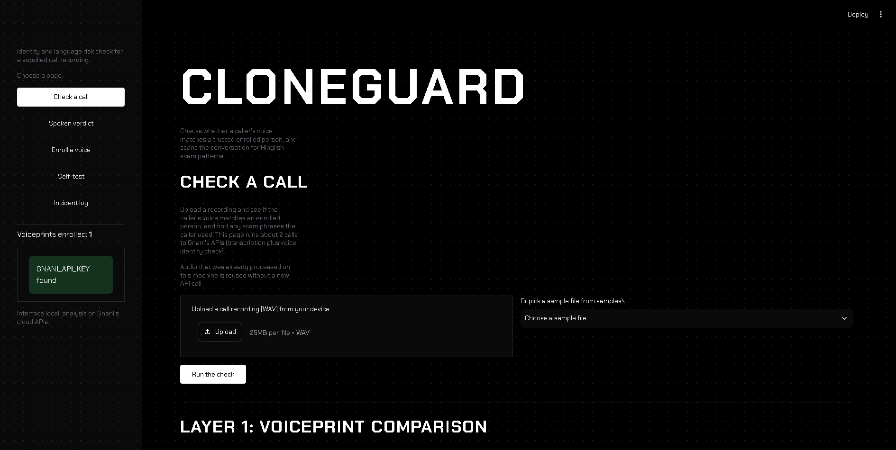
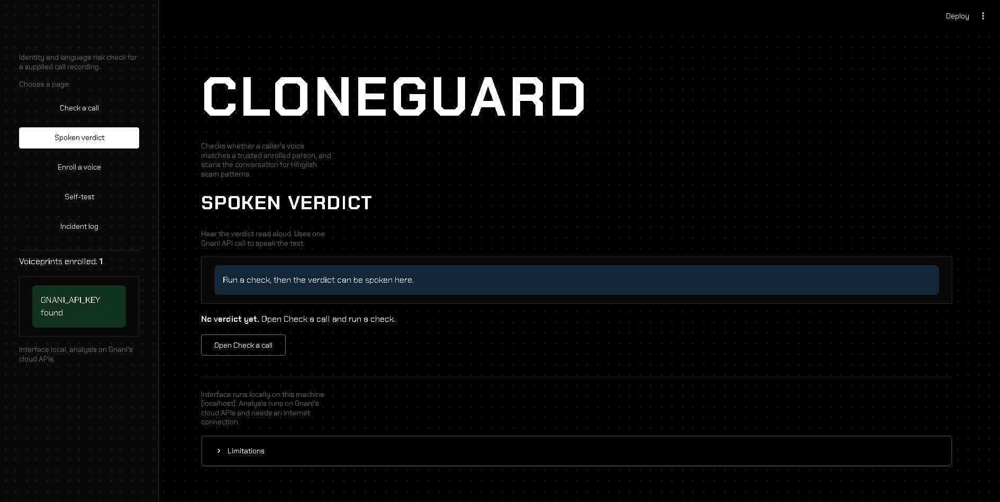
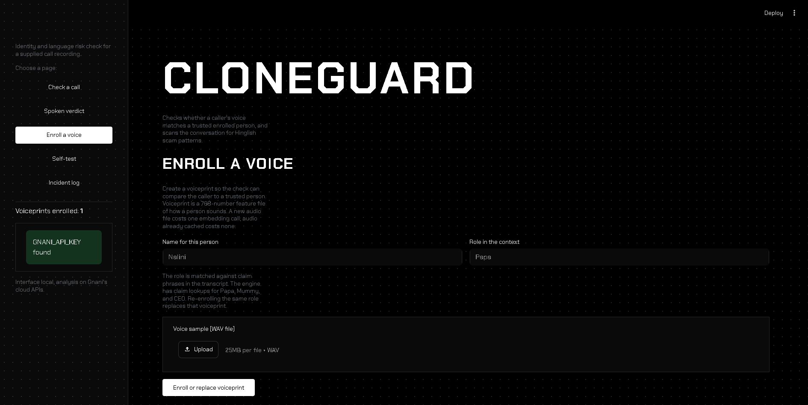
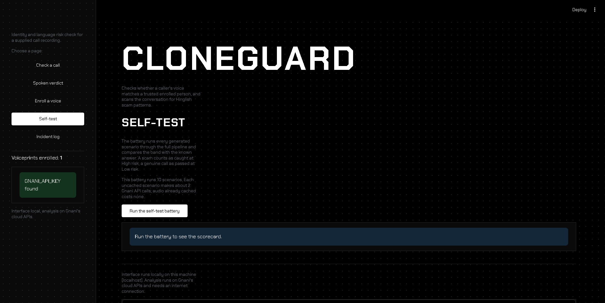
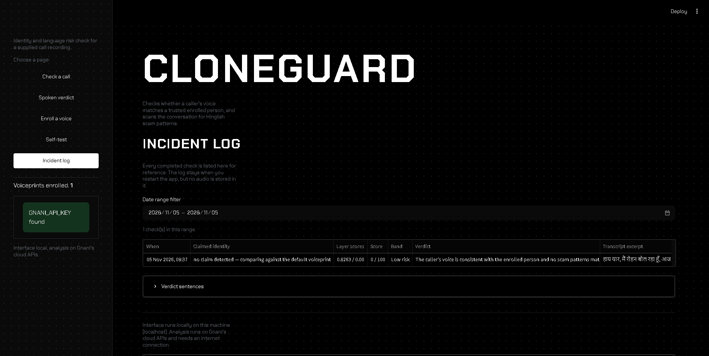

# CloneGuard

CloneGuard is a desktop tool that checks a phone call for signs of impersonation. It compares the caller's voice against a stored voice fingerprint of the person they claim to be, then reads the transcript for Hinglish (Hindi written in English letters, mixed with English) scam patterns. The screen shows both pieces of evidence and one combined risk score. The interface runs locally on your computer; the analysis runs on Gnani's cloud APIs, so an internet connection is required.

---

## Features

- **Multi-voiceprint enrollment with claimed-identity detection** — store several trusted voiceprints (for example, family members or executives); when the transcript contains a claim such as "Main Papa bol raha hoon" or "CEO bol raha hoon", the app checks that person's voiceprint.
- **Two-layer verification with composite score** — Layer 1 computes cosine similarity against the enrolled voiceprint; Layer 2 scans the transcript for Hinglish red flags; both layers stay visible and combine into one score with a plain-English verdict.
- **Built-in Hinglish scam-call generator** — creates scam and genuine call scripts spoken by Timbre voices with a phone-line noise effect, so the demo does not depend on external recordings.
- **Self-Test Harness** — one click runs a battery of scenarios with known answers through the full pipeline and prints a calibration scorecard (scam caught, genuine passed, weakest scenario, threshold sweep) with PDF export.
- **Streamlit UI at localhost** — local desktop interface served at `http://localhost:8501`; enrollment, checking, generation, self-test, and reports all in one app.
- **Incident log** — keeps a local record of every check: timestamp, claimed identity, layer scores, verdict, and transcript excerpt; filterable by date.
- **PDF evidence report per check** — shareable PDF with both layer scores, matched red-flag phrases, transcript excerpt, verdict, and the four known limitations.
- **Spoken verdict via Timbre** — reads the verdict aloud in a selectable voice so the result works hands-free and in demos.

---

## How it works

**Layer 1 — Voice match.** The caller's audio is turned into a voiceprint (a list of 768 numbers that describes how a voice sounds, also called an embedding). This is compared with the enrolled voiceprint of the claimed person using cosine similarity (a 0-to-1 score where 1 means identical voices). The threshold is 0.55.

**Layer 2 — Scam-pattern scan.** The same audio is transcribed by Prisma (Gnani's speech-to-text service) and scanned for 32 dual-script Hinglish red-flag patterns across six categories: urgency, OTP or bank details, authority impersonation, threats, emotional manipulation, and deceptive calls to action. Each match records the category, phrase, and transcript snippet.

**Composite verdict.** Each layer produces a 0-to-1 risk number. The two risks are combined with equal weights (0.5 / 0.5) into a 0–100 composite score, then mapped to a band:
- **0–29 Low risk** — "The caller's voice is consistent with the enrolled person and no scam patterns matched. This is a weak signal, not a clearance."
- **30–59 Caution** — "One layer raised a concern. Ask a verification question the real person would answer."
- **60–100 High risk** — "The caller does not match the claimed person's voice, or the conversation uses known scam patterns, or both. Treat this call as unsafe."

The screen always shows both layer scores, the threshold, the matched phrases, and the plain-language sentence.

---

## Measured results

All numbers come from the Self-Test Harness calibration run (`data/selftest_runs.json`, run `run_20261107_183026_08f8`):

| Metric | Result |
|---|---|
| Scam calls caught | **7 / 7** (all landed in High risk) |
| Genuine calls passed | **3 / 3** (all landed in Low risk) |
| Caution count | **0** |
| Error count | **0** |
| Threshold sweep (0.45–0.65) | **Flat** — all five settings returned 7/7 and 3/3 |
| Same-speaker cosine | **0.7306** |
| Different-speaker cosine | **0.2964** |
| Separation gap | **0.4342** |
| Identity threshold used | **0.55** |

Voice measurements are from `voiceprint_test.py` (deterministic — the same audio always produces the same numbers). The Self-Test Harness runs at 0 credits on this machine because speech-to-text and embedding results are cached in `data/`.

---

## Screenshots

| Page | Screenshot |
|---|---|
| Check a call |  |
| Spoken verdict |  |
| Enroll a voice |  |
| Self-test |  |
| Incident log |  |

## Quick start

**Prerequisites**
- Python 3.14+
- Install dependencies:
  ```bash
  pip install -r requirements.txt
  ```

**Set your Gnani API key**
- Windows PowerShell:
  ```powershell
  $env:GNANI_API_KEY = "your-key-here"
  ```
- Or add `GNANI_API_KEY` as a system environment variable and restart the terminal.

Never commit your real key: do not paste it into files you push, and prefer setting it as a system environment variable over typing it in a terminal (terminal history can store it).

**Run the app**
```bash
streamlit run app.py
```
The app opens at `http://localhost:8501`.

---

## Limitations

These are the boundaries of what the evidence supports. They are stated in the UI, the PDF report, and every public description:

1. **A perfect clone of the enrolled voice passes Layer 1.** Matching an identity is not proof that the audio is genuine.
2. **A mismatch is not proof of synthetic audio.** Layer 1 flags an identity mismatch between the caller and the enrolled voice. That catches clones and human impersonators alike. It does not, on its own, show that the audio was machine-generated.
3. **The analysis runs on Gnani's cloud.** Audio leaves the machine, and the app stops working without an internet connection. It is a local interface with cloud inference.
4. **A partial search cannot prove absence.** "No patterns found" means the scan did not match its phrase list. It does not mean the call is safe, and the app must never say that it does.

---

## Project links

- **Entry point:** [`docs/00_PROJECT_INDEX.md`](docs/00_PROJECT_INDEX.md) — session rules, build order, critical numbers, and navigation to all documents.
- [Artifacts — evidence bundle for judges](artifacts/)
- [Fresh-machine end-to-end test prompt](docs/08_E2E_TEST_PROMPT.md)
- Built for the **Gnani AI Great Indian AI Internship Challenge** (deadline 10 November 2026).
- Mandatory hashtags: `#GnaniAI` `#GreatIndianAIInternshipChallenge`